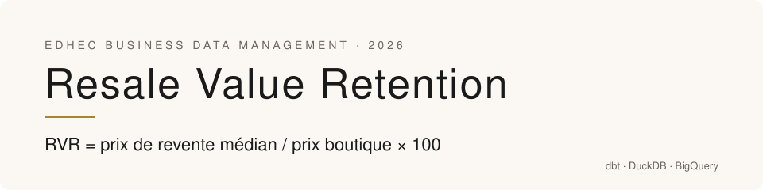
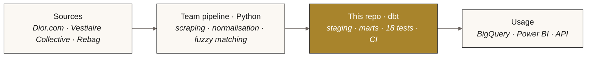
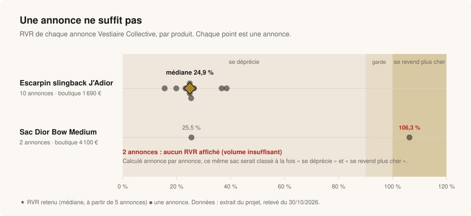
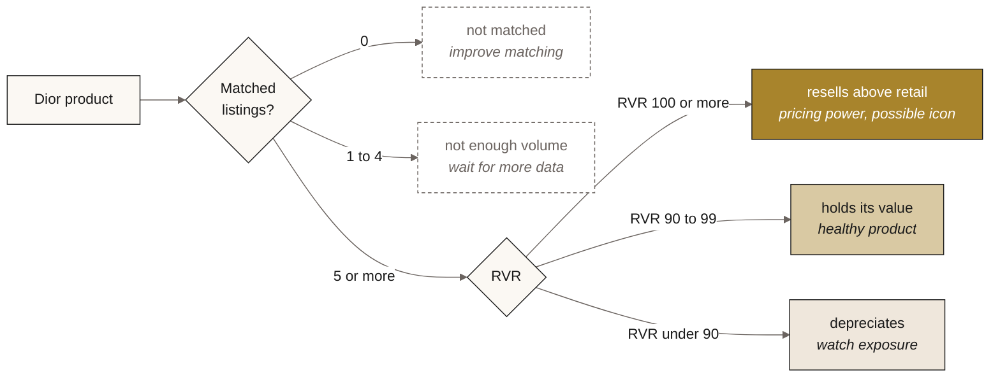
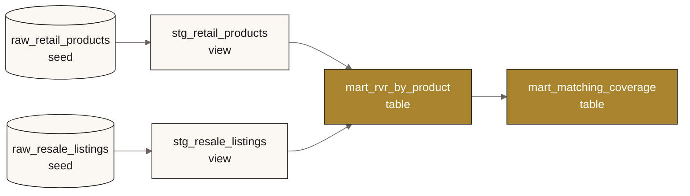

<p align="center">
  
</p>

<p align="center">
  <a href="https://github.com/MosesKing/dior-rvr-dbt/actions/workflows/ci.yml"></a>
  
  
  
  
  
</p>

<p align="center">
  <b>Which Dior products hold their value on the resale market?</b><br>
  The dbt transformation layer of our EDHEC x Dior project: reliable, tested numbers, ready for a decision.
</p>

<p align="center">
  <a href="#the-project">Project</a> ·
  <a href="#what-dbt-adds">What dbt adds</a> ·
  <a href="#one-listing-is-not-enough">Results</a> ·
  <a href="#from-number-to-decision">Decision</a> ·
  <a href="#run-it">Run it</a> ·
  <a href="#team">Team</a> ·
  <a href="README.md">🇫🇷 Français</a>
</p>

---

## The project

For EDHEC's **Business Data Management** course (MSc Data & AI, 2026), our team built a pipeline that compares Dior boutique prices with resale market prices (Vestiaire Collective, Rebag). The idea: use resale as a signal of a product's perceived value.

The core metric is **RVR** (Resale Value Retention):

```
RVR = median resale price / retail price × 100
```

| RVR | Reading | What it means for Dior |
|:---|:---|:---|
| **≥ 100%** | resells above retail | Untapped pricing power, possible future icon |
| **90 to 100%** | holds its value | A product that protects the brand |
| **< 90%** | depreciates | Normal consumer-good behaviour, or a sign of overexposure |

### Why it matters

| Goal | What RVR enables |
|:---|:---|
| **Spot underpriced products** | A product reselling at or above retail shows room on price. |
| **Detect future icons** | Strong value retention often comes before icon status (Lady Dior, Saddle). |
| **Evaluate scarcity** | A product gone from boutiques but strong on resale shows well-managed scarcity. |
| **Protect brand equity** | Weak resale can flag overexposure or a perceived quality problem. |

The team's full pipeline (scraping, normalisation, listing matching, BigQuery, FastAPI, Docker) lives here: **[Business_Data_Management_EDHEC_2026_DIOR](https://github.com/Loicmasioni/Business_Data_Management_EDHEC_2026_DIOR)**.

---

## What dbt adds

In the original pipeline, RVR is computed in Python, **one listing at a time**, then loaded into BigQuery. This repo adds a dbt layer between the matched data and the numbers people see.



| | Before (Python) | With dbt |
|:---|:---|:---|
| **RVR calculation** | One value per listing | One value per product: the **median** of its listings |
| **Minimum volume** | None: a single listing can classify a product | No RVR below **5 listings** (`min_listings` variable) |
| **Data tests** | None | **18 tests**: uniqueness, nulls, categories, listing ↔ product links, business rules |
| **Matching coverage** | Not measured | Tracked as a KPI, per category |
| **Business reading** | Technical labels | Readable status: *depreciates, holds value, resells above retail, not enough volume, not matched* |
| **Documentation** | README | `dbt docs`: every model described, with lineage |
| **Continuous checks** | Manual | GitHub Actions CI on every push |
| **Warehouse** | BigQuery only | DuckDB locally, BigQuery in production, same code |

---

## One listing is not enough

<p align="center">
  
</p>

The **Dior Bow Medium bag** (€4,100 in boutique) has only 2 listings: one at €1,045, one at €4,358.

- Computed listing by listing, this bag is both *Depreciating* (25.5%) and *Investment-like* (106.3%).
- With dbt it is flagged **not enough volume**, and no RVR is shown until there are 5 listings.

The **J'Adior slingback pump** has 10 listings, between 15.6% and 38.5%. The median, **24.9%**, is a stable number you can act on: this model depreciates sharply.

### Output on the sample

| Product | Category | Retail | Listings | Median resale | RVR | Status (as output) |
|:---|:---|---:|---:|---:|---:|:---|
| J'Adior slingback pump | shoes | €1,690 | 10 | €420 | **24.9%** | se déprécie |
| Dior Bow Medium bag | bags | €4,100 | 2 | €2,701.50 | n/a | volume insuffisant |
| Mule 30M Dior Or | shoes | €950 | 0 | n/a | n/a | non rattaché |
| Cannage overshirt | ready-to-wear | €2,700 | 0 | n/a | n/a | non rattaché |

Status labels are in French because the project's stakeholders worked in French.

**Matching coverage** (`mart_matching_coverage`): 2 of 4 products have matched listings. In the project this was the real bottleneck: the Vestiaire scraper found few listings per product. Tracking it as a KPI shows where to improve matching before trusting the RVR.

---

## From number to decision

Every product gets a status from the [`rvr_status`](macros/rvr_status.sql) macro:



What this changes for the project's goal: a merchandising team never sees a number built on one or two listings. A product is called a "possible icon" only when the market confirms it.

---

## Models



| Model | Role |
|:---|:---|
| [`stg_retail_products`](models/staging/stg_retail_products.sql) | Typed retail prices, normalised categories |
| [`stg_resale_listings`](models/staging/stg_resale_listings.sql) | One row per listing, typed prices and dates |
| [`mart_rvr_by_product`](models/marts/mart_rvr_by_product.sql) | Median RVR and status, one row per product |
| [`mart_matching_coverage`](models/marts/mart_matching_coverage.sql) | Matching coverage per category |

### Tests

| Type | What is checked |
|:---|:---|
| `unique`, `not_null` | Product and listing IDs, prices, status |
| `accepted_values` | Categories, currency (EUR), the 5 statuses |
| `relationships` | Every listing points to a product that exists |
| [`assert_no_rvr_below_min_listings`](tests/assert_no_rvr_below_min_listings.sql) | No RVR shown below the minimum volume |
| [`assert_retail_price_positive`](tests/assert_retail_price_positive.sql) | No zero or negative retail price (RVR divides by it) |

### Technical choices

- **Median, not mean**: one €4,358 listing should not drag the whole product.
- **Same code on two warehouses**: the [`median`](macros/median.sql) macro uses `adapter.dispatch`. Exact `median()` on DuckDB, `APPROX_QUANTILES` on BigQuery, which has no median function.
- **Prices as `numeric`**: no floats for money.
- **DuckDB locally and in CI**: the project runs in seconds, no cloud account needed.

---

## Run it

```bash
git clone https://github.com/MosesKing/dior-rvr-dbt.git && cd dior-rvr-dbt
pip install -r requirements.txt

make build    # seeds, models and 18 tests on DuckDB
make docs     # docs and lineage on http://localhost:8080
make charts   # regenerate the charts in this README
```

On BigQuery:

```bash
GCP_PROJECT=my-project dbt build --profiles-dir . --target bigquery
```

---

## Limits and next steps

- **The sample is small**: 4 products and 12 listings taken from the project. It shows the logic and the tests, not conclusions about the brand.
- **Plug in the real tables**: replace the seeds with dbt `sources` on the team's BigQuery data mart.
- **Track RVR over time**: a dbt `snapshot` of listings to see whether a product gains or loses value.
- **Data freshness**: `dbt source freshness` on scrape dates.

---

## Team

EDHEC Business Data Management group project, 2026:

- [@Loicmasioni](https://github.com/Loicmasioni)
- [@hink3at](https://github.com/hink3at)
- [@Sicong008](https://github.com/Sicong008)
- [@MosesKing](https://github.com/MosesKing) · Moesaeah King

<sub>Academic project, not affiliated with or endorsed by Dior. Data is a small sample of public prices from dior.com and Vestiaire Collective. Code under MIT license.</sub>
