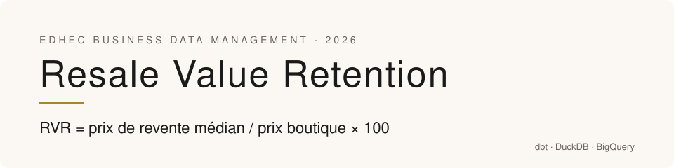
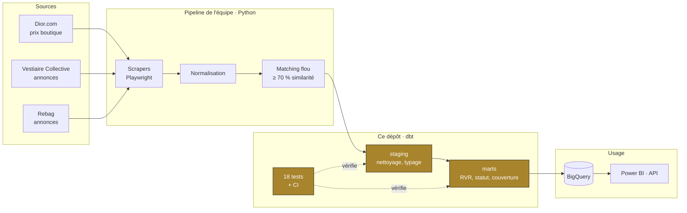
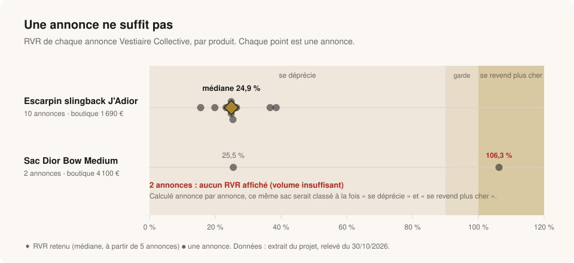
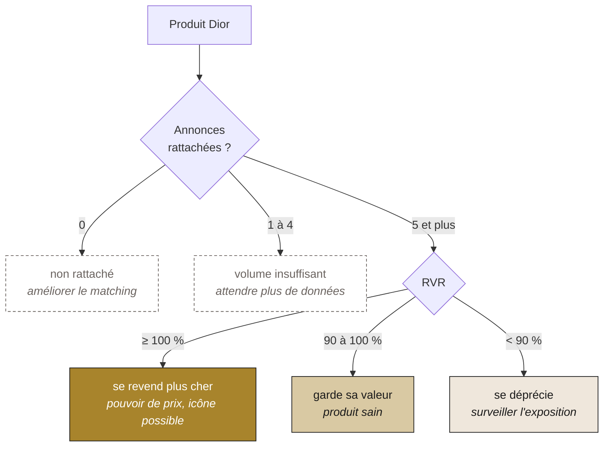
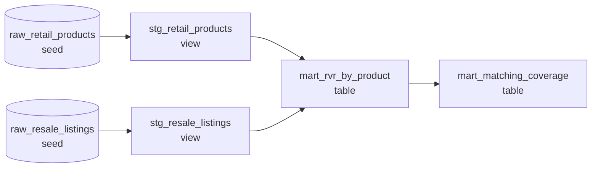

<p align="center">
  
</p>

<p align="center">
  <a href="https://github.com/MosesKing/dior-rvr-dbt/actions/workflows/ci.yml"></a>
  
  
  
  
  
</p>

<p align="center">
  <b>Quels produits Dior gardent leur valeur sur le marché de la revente ?</b><br>
  La couche de transformation dbt de notre projet EDHEC x Dior : des chiffres fiables, testés, prêts pour une décision.
</p>

<p align="center">
  <a href="#le-projet">Le projet</a> ·
  <a href="#ce-que-dbt-ajoute">Ce que dbt ajoute</a> ·
  <a href="#une-annonce-ne-suffit-pas">Résultats</a> ·
  <a href="#du-chiffre-à-la-décision">Décision</a> ·
  <a href="#lancer-le-projet">Lancer</a> ·
  <a href="#léquipe">Équipe</a> ·
  <a href="README.en.md">🇬🇧 English</a>
</p>

---

## Le projet

Pour le cours **Business Data Management** de l'EDHEC (MSc Data & IA, 2026), notre équipe a construit un pipeline qui compare les prix boutique de Dior aux prix du marché de la revente (Vestiaire Collective, Rebag). L'idée : utiliser la revente comme un signal de la valeur perçue d'un produit.

L'indicateur central est le **RVR** (Resale Value Retention) :

```
RVR = prix de revente médian / prix boutique × 100
```

| RVR | Lecture | Ce que ça veut dire pour Dior |
|:---|:---|:---|
| **≥ 100 %** | se revend plus cher | Pouvoir de prix pas encore exploité, candidat « icône » |
| **90 à 100 %** | garde sa valeur | Produit qui protège l'image de la marque |
| **< 90 %** | se déprécie | Comportement normal d'un bien de consommation, ou signe de surexposition |

### Pourquoi c'est utile

| Objectif | Ce que le RVR permet |
|:---|:---|
| **Repérer les produits sous-évalués** | Un produit qui se revend au prix boutique ou plus cher montre une marge de prix possible. |
| **Détecter les futures icônes** | Une forte rétention de valeur arrive souvent avant le statut d'icône (Lady Dior, Saddle). |
| **Évaluer la rareté** | Un produit retiré des boutiques mais fort à la revente montre une rareté bien gérée. |
| **Protéger l'image de marque** | Une revente faible peut signaler une surexposition ou un problème de qualité perçue. |

Le pipeline complet de l'équipe (scraping, normalisation, matching des annonces, BigQuery, API FastAPI, Docker) est ici : **[Business_Data_Management_EDHEC_2026_DIOR](https://github.com/Loicmasioni/Business_Data_Management_EDHEC_2026_DIOR)**.

---

## Ce que dbt ajoute

Dans le pipeline d'origine, le RVR est calculé en Python, **annonce par annonce**, puis chargé dans BigQuery. Ce dépôt ajoute une couche dbt entre les données rattachées et les chiffres que l'on montre.



| | Avant (Python) | Avec dbt |
|:---|:---|:---|
| **Calcul du RVR** | Une valeur par annonce | Une valeur par produit : la **médiane** des annonces |
| **Volume minimum** | Aucun : une seule annonce peut classer un produit | Pas de RVR sous **5 annonces** (variable `min_listings`) |
| **Tests sur les données** | Aucun | **18 tests** : unicité, valeurs nulles, catégories, liens annonces ↔ produits, règles métier |
| **Couverture du matching** | Pas mesurée | Suivie comme un KPI, par catégorie |
| **Lecture métier** | Labels techniques en anglais | Statut lisible : *se déprécie, garde sa valeur, se revend plus cher, volume insuffisant, non rattaché* |
| **Documentation** | README | `dbt docs` : description de chaque modèle et lineage |
| **Contrôle continu** | Manuel | CI GitHub Actions à chaque push |
| **Entrepôt** | BigQuery uniquement | DuckDB en local, BigQuery en production, même code |

---

## Une annonce ne suffit pas

<p align="center">
  
</p>

Le **sac Dior Bow Medium** (4 100 € en boutique) n'a que 2 annonces : l'une à 1 045 €, l'autre à 4 358 €.

- Calculé annonce par annonce, ce sac est à la fois *Depreciating* (25,5 %) et *Investment-like* (106,3 %).
- Avec dbt, il est marqué **volume insuffisant**, et aucun RVR n'est affiché tant qu'il n'y a pas 5 annonces.

L'**escarpin slingback J'Adior** a 10 annonces, entre 15,6 % et 38,5 %. La médiane, **24,9 %**, est un chiffre stable sur lequel on peut décider : ce modèle se déprécie fortement.

### Résultat sur l'échantillon

| Produit | Catégorie | Boutique | Annonces | Médiane revente | RVR | Statut |
|:---|:---|---:|---:|---:|---:|:---|
| Escarpin slingback J'Adior | chaussures | 1 690 € | 10 | 420 € | **24,9 %** | se déprécie |
| Sac Dior Bow Medium | sacs | 4 100 € | 2 | 2 701,50 € | n.d. | volume insuffisant |
| Mule 30M Dior Or | chaussures | 950 € | 0 | n.d. | n.d. | non rattaché |
| Surchemise Cannage | prêt-à-porter | 2 700 € | 0 | n.d. | n.d. | non rattaché |

**Couverture du matching** (`mart_matching_coverage`) : 2 produits sur 4 ont des annonces rattachées. Dans le projet, c'était le vrai goulot : le scraping de Vestiaire trouvait peu d'annonces par produit. Le suivre comme un KPI montre où améliorer le matching avant de faire confiance au RVR.

---

## Du chiffre à la décision

Chaque produit reçoit un statut, calculé par la macro [`rvr_status`](macros/rvr_status.sql) :



Ce que ça change pour l'objectif du projet : une équipe merchandising ne voit jamais un chiffre construit sur une ou deux annonces. Un produit est classé « icône possible » seulement quand le marché le confirme.

---

## Modèles



| Modèle | Rôle |
|:---|:---|
| [`stg_retail_products`](models/staging/stg_retail_products.sql) | Prix boutique typés, catégories normalisées |
| [`stg_resale_listings`](models/staging/stg_resale_listings.sql) | Une ligne par annonce, prix et dates typés |
| [`mart_rvr_by_product`](models/marts/mart_rvr_by_product.sql) | RVR médian et statut, une ligne par produit |
| [`mart_matching_coverage`](models/marts/mart_matching_coverage.sql) | Couverture du matching par catégorie |

### Tests

| Type | Ce qui est vérifié |
|:---|:---|
| `unique`, `not_null` | Identifiants produits et annonces, prix, statut |
| `accepted_values` | Catégories, devise (EUR), les 5 statuts |
| `relationships` | Chaque annonce pointe vers un produit qui existe |
| [`assert_no_rvr_below_min_listings`](tests/assert_no_rvr_below_min_listings.sql) | Aucun RVR affiché sous le volume minimum |
| [`assert_retail_price_positive`](tests/assert_retail_price_positive.sql) | Aucun prix boutique nul ou négatif (le RVR divise par ce prix) |

### Choix techniques

- **Médiane, pas moyenne** : une annonce à 4 358 € ne doit pas tirer tout le produit.
- **Même code sur deux entrepôts** : la macro [`median`](macros/median.sql) utilise `adapter.dispatch`. `median()` exacte sur DuckDB, `APPROX_QUANTILES` sur BigQuery, qui n'a pas de fonction médiane.
- **Prix en `numeric`** : pas de flottants pour de l'argent.
- **DuckDB en local et en CI** : le projet se lance en quelques secondes, sans compte cloud.

---

## Lancer le projet

```bash
git clone https://github.com/MosesKing/dior-rvr-dbt.git && cd dior-rvr-dbt
pip install -r requirements.txt

make build    # seeds, modèles et 18 tests sur DuckDB
make docs     # documentation et lineage sur http://localhost:8080
make charts   # régénère les graphiques de ce README
```

Sur BigQuery :

```bash
GCP_PROJECT=mon-projet dbt build --profiles-dir . --target bigquery
```

<details>
<summary><b>Structure du dépôt</b></summary>

```
dior-rvr-dbt/
├── models/
│   ├── staging/            # nettoyage et typage
│   ├── marts/              # RVR par produit, couverture du matching
│   └── schema.yml          # descriptions et tests
├── macros/
│   ├── rvr_status.sql      # statut lisible par le métier
│   └── median.sql          # médiane DuckDB / BigQuery
├── tests/                  # tests singuliers (règles métier)
├── seeds/                  # extrait des données du projet
├── scripts/render_charts.py
├── assets/                 # graphiques du README
├── .github/workflows/ci.yml
├── dbt_project.yml
└── profiles.yml            # DuckDB (défaut) et BigQuery
```

</details>

---

## Limites et suite

- **L'échantillon est petit** : 4 produits et 12 annonces, extraits du projet. Il sert à montrer la logique et les tests, pas à tirer des conclusions sur la marque.
- **Brancher les vraies tables** : remplacer les seeds par des `sources` dbt sur le data mart BigQuery de l'équipe.
- **Suivre le RVR dans le temps** : un `snapshot` dbt des annonces pour voir si un produit gagne ou perd de la valeur.
- **Fraîcheur des données** : `dbt source freshness` sur les dates de scraping.

---

## L'équipe

Projet de groupe EDHEC Business Data Management, 2026 :

- [@Loicmasioni](https://github.com/Loicmasioni)
- [@hink3at](https://github.com/hink3at)
- [@Sicong008](https://github.com/Sicong008)
- [@MosesKing](https://github.com/MosesKing) · Moesaeah King

<sub>Projet académique, sans lien avec la maison Dior ni approuvé par elle. Les données sont un petit extrait de prix publics relevés sur dior.com et Vestiaire Collective. Code sous licence MIT.</sub>
